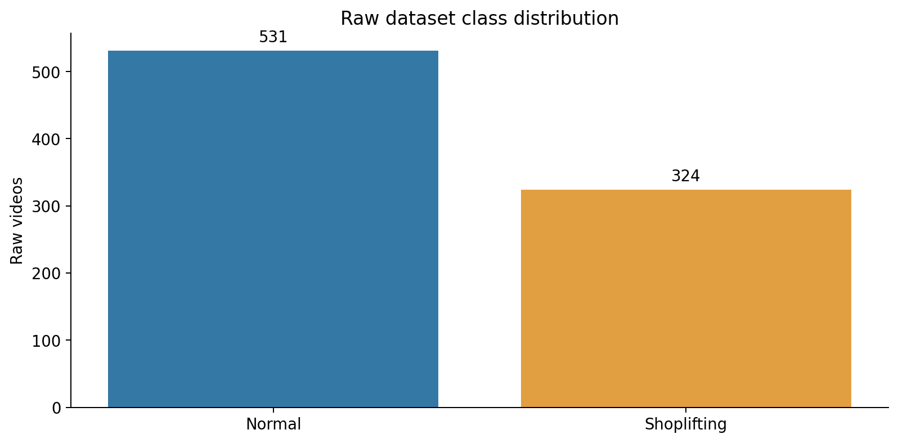
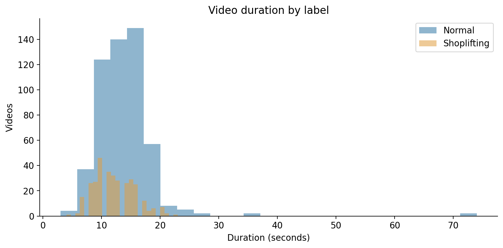
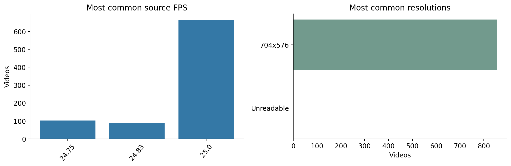
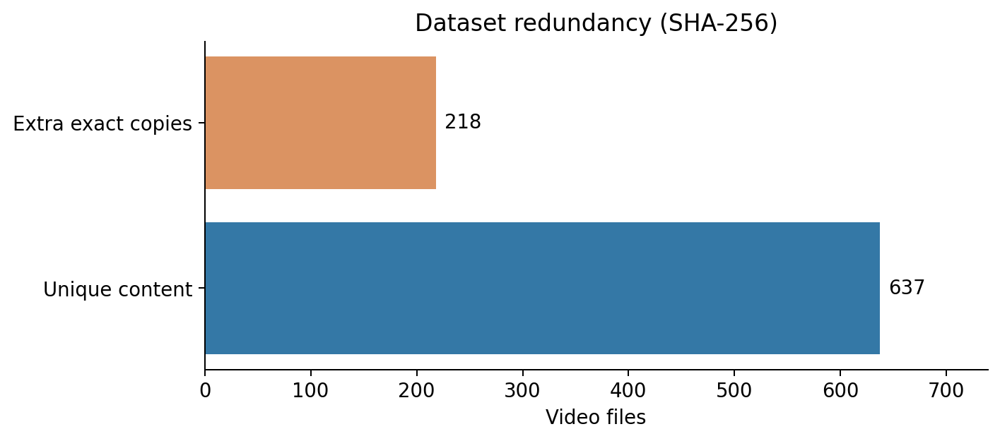
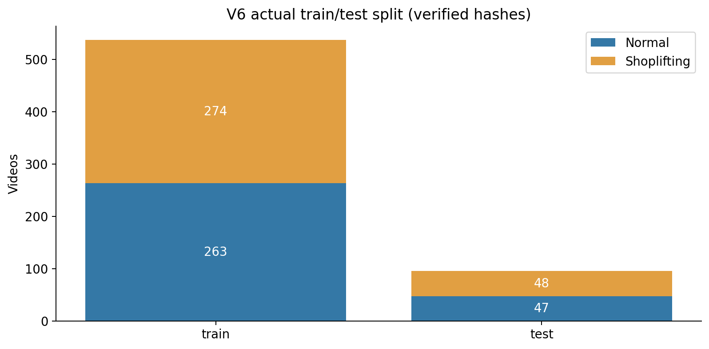
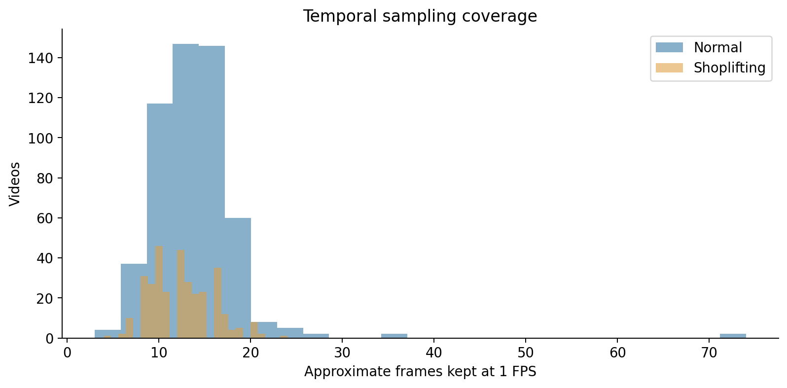

# 🛒 Shoplifting Detection Using CNN & BiLSTM

### Deep Learning for CCTV Video Classification


A deep learning project for detecting **shoplifting activities in CCTV surveillance videos** using a Convolutional Neural Network (CNN) combined with a Bidirectional Long Short-Term Memory network (BiLSTM).

The system analyzes spatial information from individual video frames and temporal relationships across the video to classify activities into two categories:

- **Normal Shopping**
- **Shoplifting**

The project covers Exploratory Data Analysis (EDA), dataset cleaning, video preprocessing, data augmentation, model training, and performance evaluation.

---

## 🎯 Project Objectives

The main objectives of this project are:

1. Explore and analyze CCTV video data.
2. Identify duplicate videos and potential data-quality issues.
3. Preprocess videos into sequences of image frames.
4. Apply temporally consistent data augmentation.
5. Build a CNN-BiLSTM deep learning architecture.
6. Classify videos as Normal or Shoplifting.
7. Evaluate performance using classification metrics.

---

## 🏆 Model Performance

The trained CNN-BiLSTM model achieved **95.79% accuracy** on the internal test dataset.

| Metric | Result |
|---|---:|
| **Test Accuracy** | **95.79%** |
| Macro Precision | 96.08% |
| Macro Recall | 95.83% |
| **Macro F1-Score** | **95.79%** |
| Shoplifting Recall | 91.67% |
| Correct Predictions | 91 |
| Incorrect Predictions | 4 |
| Total Test Videos | 95 |

### Confusion Matrix

| Actual / Predicted | Normal | Shoplifting |
|---|---:|---:|
| **Normal** | 47 | 0 |
| **Shoplifting** | 4 | 44 |

### Results Interpretation

The model correctly classified **91 out of 95 videos**.

- All 47 Normal Shopping test videos were correctly classified.
- 44 out of 48 Shoplifting videos were correctly identified.
- Four Shoplifting videos were incorrectly classified as Normal.
- No Normal Shopping videos were incorrectly classified as Shoplifting.

> **Evaluation Note:** These results come from an internal test split that was inspected during earlier experimentation. Independent performance on unseen stores or camera environments has not yet been established.

---

# 📊 Exploratory Data Analysis (EDA)

EDA was performed to understand the dataset's characteristics, detect data-quality issues, and guide preprocessing decisions.

The analysis includes:

- Dataset class distribution
- Video duration statistics
- FPS analysis
- Video resolution analysis
- Duplicate detection
- Temporal sampling coverage
- Dataset cleaning
- Train/Test distribution
- Video metadata validation

The complete EDA notebook is available in:

**[Shoplifting_EDA.ipynb](Shoplifting_EDA.ipynb)**

## 1. Dataset Overview

The original dataset contains **855 CCTV videos** divided into two classes.

| Class | Videos | Percentage |
|---|---:|---:|
| Normal Shopping | 531 | 62.11% |
| Shoplifting | 324 | 37.89% |
| **Total** | **855** | **100%** |

The original dataset is moderately imbalanced, containing more Normal Shopping videos than Shoplifting videos.

### Class Distribution



---

## 2. Video Duration Analysis

Video duration was measured using the original frame count and recorded FPS.

The EDA successfully retrieved valid metadata from **854 out of 855 videos**.

### Duration Statistics by Class

| Statistic | Normal Shopping | Shoplifting |
|---|---:|---:|
| Videos with Valid Metadata | 530 | 324 |
| Minimum Duration | 3.00 s | 4.00 s |
| Median Duration | 14.00 s | 12.00 s |
| Mean Duration | 13.93 s | 12.22 s |
| Maximum Duration | 74.00 s | 23.03 s |

### Overall Duration Statistics

- **Median video duration:** 13 seconds
- **Videos shorter than 5 seconds:** 3
- **Videos longer than 60 seconds:** 2

These measurements were calculated from the original video inventory before duplicate removal.

The dataset contains videos of different lengths, so the model must support variable-length frame sequences.

### Video Duration Distribution



---

## 3. Frame Rate (FPS) Analysis

The EDA showed that the videos have relatively consistent frame rates.

| Metric | Value |
|---|---:|
| Median FPS | 25 |
| Normal Shopping Mean FPS | 24.97 |
| Shoplifting Mean FPS | 24.92 |

The original videos generally run at approximately **25 FPS**.

Instead of processing every original frame, the model extracts frames at **1 FPS** to reduce computational cost.

### FPS Distribution



---

## 4. Video Resolution Analysis

The EDA revealed that almost all valid videos share the same resolution.

| Resolution | Videos |
|---|---:|
| **704 × 576** | **854** |
| Unreadable Metadata | 1 |
| **Total** | **855** |

This consistency indicates that the dataset largely uses a similar video format and camera setup.

However, models trained on footage from a consistent environment may learn background-specific features and might not generalize well to different cameras or stores.

During preprocessing, all frames are resized to **112 × 112 pixels**.

---

## 5. Duplicate Video Detection

Exact duplicate detection was performed using **SHA-256 hashing**.

Each video file was assigned a SHA-256 hash to identify byte-identical copies.

### Duplicate Detection Results

| Metric | Videos |
|---|---:|
| Original Video Files | 855 |
| Extra Exact Duplicate Copies | 218 |
| Unique Videos | 637 |

The dataset contained:

- **419 unique hash groups** containing one video each.
- **218 duplicate hash groups** containing two identical video files each.

Removing redundant copies reduced the dataset from 855 to 637 videos.

### Duplicate Summary



### Why Remove Duplicates?

Duplicate removal helps:

- Reduce redundant training examples.
- Improve data quality.
- Prevent exact copies from appearing in both training and testing.
- Make the evaluation more meaningful.

**Important:** SHA-256 detects exact file duplicates only. It cannot identify all visually similar videos, re-encoded copies, or overlapping segments from the same recording.

---

## 6. Final Dataset Cleaning

After exact duplicate removal, five additional known overlapping videos were excluded.

| Cleaning Stage | Video Count |
|---|---:|
| Original Dataset | 855 |
| Exact Duplicate Copies Removed | 218 |
| Unique Videos | 637 |
| Known Overlap Exclusions | 5 |
| **Final Cleaned Dataset** | **632** |

The final dataset contains **632 videos**.

The five overlap exclusions address known cases; they do not establish that every recording overlap in the dataset has been found.

---

## 7. Train/Test Split

The final dataset was divided into training and testing sets.

| Split | Normal | Shoplifting | Total |
|---|---:|---:|---:|
| Training | 263 | 274 | 537 |
| Testing | 47 | 48 | 95 |
| **Total** | **310** | **322** | **632** |

The resulting distribution is approximately:

- **85% Training**
- **15% Testing**

The training and testing subsets contain both classes.

### Split Verification

The EDA verified the saved model split using SHA-256 video identities.

- **Matching hashes:** 632 / 632
- **Exact-hash collisions between Train and Test:** 0

This confirms that no byte-identical video appears in both subsets.

It does not rule out non-identical videos originating from overlapping recording sessions.

### Train/Test Distribution



---

## 8. Temporal Sampling Analysis

The model uses **1 frame per second (1 FPS)** rather than the original frame rate.

For example:

- A 10-second video produces approximately 10 sampled frames.
- A 20-second video produces approximately 20 sampled frames.

### EDA Findings

| Metric | Value |
|---|---:|
| Sampling Frequency | 1 FPS |
| Median Sampled Frames per Raw Video | 13 |
| Minimum Sampled Frames — Valid Normal Videos | 3 |
| Minimum Sampled Frames — Valid Shoplifting Videos | 4 |
| Maximum Sampled Frames — Valid Videos | 74 |

After cleaning, the training notebook processed **8,289 sampled frames across 632 videos**.

Temporal sampling reduces memory usage and computational requirements, although very brief actions can be missed between sampled frames.

### Sampled Frame Distribution



---

# ⚙️ Data Preprocessing Pipeline

The preprocessing pipeline transforms raw CCTV videos into input tensors suitable for deep learning.

    Raw CCTV Video
           |
           v
    Video Frame Extraction
           |
           v
      Sampling at 1 FPS
           |
           v
     Resize to 112 × 112
           |
           v
      BGR to RGB Conversion
           |
           v
      Pixel Normalization
           |
           v
    Variable-Length Video Tensor
           |
           v
       CNN + BiLSTM

### Image Normalization

Input pixel values are normalized to the range:

`[-1, 1]`

### Video Tensor Format

Each processed video is represented as:

`(T, 3, 112, 112)`

Where:

- `T`: Number of sampled frames
- `3`: RGB channels
- `112 × 112`: Frame dimensions

Because videos have different durations, the number of sampled frames varies between videos.

---

# 🔄 Data Augmentation

Data augmentation is applied during training.

| Augmentation Technique | Configuration |
|---|---|
| Horizontal Flip | 50% probability |
| Brightness Adjustment | ±15% |
| Contrast Adjustment | ±15% |
| Color/Saturation Adjustment | ±15% |

### Temporally Consistent Augmentation

The same augmentation settings are applied to every frame within a video.

For example, if a video is selected for horizontal flipping, every sampled frame in that video is flipped.

This avoids artificial temporal inconsistencies.

**Augmentation is applied only during training, not testing or inference.**

---

# 🧠 CNN + BiLSTM Architecture

The model combines spatial feature extraction and temporal sequence modeling.

## Architecture Overview

    Input Video
         |
         v
    Frame Sampling (1 FPS)
         |
         v
    CNN Feature Extractor
         |
         v
    Feature Projection (160)
         |
         v
    Bidirectional LSTM
         |
         v
    Masked Mean Pooling + Max Pooling
         |
         v
    Feature Concatenation
         |
         v
    Fully Connected Classifier
         |
         v
    Normal / Shoplifting

## 1. CNN Feature Extraction

The CNN extracts visual features from individual frames.

It consists of four convolutional blocks with output channel sizes:

| CNN Block | Output Channels |
|---|---:|
| Block 1 | 24 |
| Block 2 | 48 |
| Block 3 | 96 |
| Block 4 | 160 |

The network uses:

- Convolutional layers
- Group Normalization
- SiLU activation
- Adaptive Average Pooling

A linear projection produces a 160-dimensional feature vector for each sampled frame.

## 2. Bidirectional LSTM

The BiLSTM processes sequences of extracted frame features.

It learns temporal relationships in both forward and backward directions.

| Parameter | Value |
|---|---:|
| Input Size | 160 |
| Hidden Size | 128 |
| Bidirectional | Yes |
| Output Features per Frame | 256 |

## 3. Temporal Pooling

The model combines two aggregation methods.

**Masked Mean Pooling**

Calculates the average representation across valid video frames.

**Masked Max Pooling**

Selects the strongest temporal feature activations.

The two 256-dimensional representations are concatenated into a 512-dimensional feature vector.

Padding is masked to ensure that it does not affect the final video representation.

## 4. Classification Head

The concatenated features are passed through fully connected layers.

The classifier uses Layer Normalization, Dropout, Linear layers, and SiLU activation.

The final output contains two logits corresponding to the two video classes.

### Total Trainable Parameters

**998,090**

---

# 🚀 Training Configuration

The model was developed and trained using PyTorch.

| Hyperparameter | Value |
|---|---|
| Model | CNN + BiLSTM |
| Framework | PyTorch |
| Optimizer | AdamW |
| Epochs | 30 |
| Batch Size | 8 |
| Initial Learning Rate | 0.001 |
| Learning Rate (Epochs 6–30) | 0.0005 |
| Weight Decay | 0.0001 |
| Loss Function | Cross Entropy |
| Label Smoothing | 0.02 |
| Gradient Clipping | 1.0 |
| Mixed Precision | CUDA AMP |
| Random Seed | 42 |
| Input Resolution | 112 × 112 |
| Frame Sampling Rate | 1 FPS |

The model was trained from randomly initialized weights.

### Final Training Metrics

At Epoch 30:

| Metric | Value |
|---|---:|
| Training Accuracy | 98.7% |
| Training Macro F1 | 98.7% |
| Training Loss | 0.098 |

Training metrics describe performance during training and should not be confused with independent evaluation performance.

---

# 📈 Final Model Evaluation

After training, the model was evaluated on the saved test split.

### Classification Report

| Class | Precision | Recall | F1-Score | Support |
|---|---:|---:|---:|---:|
| Normal | 92.16% | 100.00% | 95.92% | 47 |
| Shoplifting | 100.00% | 91.67% | 95.65% | 48 |

### Overall Metrics

| Metric | Result |
|---|---:|
| Accuracy | **95.79%** |
| Macro Precision | 96.08% |
| Macro Recall | 95.83% |
| Macro F1 | **95.79%** |

The model correctly classified 91 of 95 test videos.

Four Shoplifting videos were classified as Normal.

---

# 💻 How to Run the Project

## 1. Clone the Repository

```bash
git clone https://github.com/mahmoudshoip94/ShopliftingDetection.git
cd ShopliftingDetection
```

## 2. Install Dependencies

```bash
pip install torch torchvision opencv-python numpy pandas matplotlib scikit-learn Pillow tqdm
```

## 3. Prepare the Dataset

The original CCTV videos are not included in the repository.

Example Google Drive directory structure:

    DataSet/
    ├── non shop lifters/
    ├── shop lifters/
    ├── shoplifting_independent_v5_train_test/
    │   └── video_split.csv
    ├── shoplifting_independent_v6_no_attention/
    └── shoplifting_eda_v2/

The training notebook requires the stored split manifest at the configured path to reproduce the exact training and testing samples.

## 4. Run the EDA Notebook

Open:

[Shoplifting_EDA.ipynb](Shoplifting_EDA.ipynb)

The EDA notebook analyzes original video metadata, detects duplicates, verifies the saved split, and exports results.

Generated EDA files include:

- `raw_video_inventory.csv`
- `video_metadata.csv`
- `unique_video_inventory.csv`
- `v6_split_class_counts.csv`
- `eda_summary.json`
- `EDA_README_SNIPPET.md`

The visualizations are exported to:

`shoplifting_eda_v2/assets/eda/`

## 5. Run the Training Notebook

Open:

[Shoplifting_Independent_V6.ipynb](Shoplifting_Independent_V6.ipynb)

Run the cells in Google Colab.

The notebook performs data preparation, frame sampling, augmentation, model training, and evaluation.

## 6. Trained Model Checkpoint

The final model is saved as:

    shoplifting_independent_v6_no_attention/
    └── final_model.pt

The checkpoint contains the trained model parameters and configuration.

---

# 📂 Repository Structure

    ShopliftingDetection/
    │
    ├── README.md
    ├── Shoplifting_EDA.ipynb
    ├── Shoplifting_Independent_V6.ipynb
    │
    └── assets/
        └── eda/
            ├── class_distribution.png
            ├── duration_distribution.png
            ├── fps_resolution.png
            ├── duplicate_summary.png
            ├── split_distribution.png
            └── sampled_frames_distribution.png

The dataset and trained checkpoint are stored separately from the repository.

---

# ⚠️ Limitations

Although the model achieved promising results on the internal test dataset, several limitations should be considered.

### Dataset Size

The cleaned dataset contains 632 videos, which limits its diversity.

### Fixed Camera Environment

Most videos share the same resolution and a consistent surveillance viewpoint.

This may encourage the model to learn scene-specific patterns.

### Temporal Sampling

Sampling at 1 FPS reduces computational cost but may miss fast hand or object movements.

### Data Leakage Risk

SHA-256 duplicate removal prevents exact copies from crossing the train/test boundary.

However, visually similar or overlapping video segments may still exist.

### Test Set Reuse

The test set was inspected during earlier model development. The reported results should therefore be treated as an internal evaluation rather than an untouched benchmark.

### Generalization

Model performance has not yet been established on independent footage from different shops and camera environments.

### Responsible Use

The model performs video-level activity classification.

It does not identify a specific offender or provide definitive evidence of theft. Predictions should not be used as the sole basis for security accusations or punitive decisions.

---

# 🔮 Future Improvements

Potential improvements include:

- Collecting videos from multiple camera viewpoints.
- Expanding the dataset with additional environments.
- Evaluating on an independent external test set.
- Grouping overlapping recordings before splitting.
- Improving temporal sampling strategies.
- Investigating robustness to lighting, occlusion, and camera changes.
- Integrating the trained model into a Streamlit application.

---

# 🏁 Conclusion

This project demonstrates a deep learning approach for detecting potential shoplifting activities in CCTV videos using a CNN and BiLSTM architecture.

The EDA identified important dataset characteristics, including:

- 855 original videos
- 218 redundant exact copies
- 632 cleaned videos used in the final experiment
- Median video duration of 13 seconds
- Median original frame rate of 25 FPS
- Predominant resolution of 704 × 576
- A verified 537/95 Train/Test split with no exact-hash collisions

The trained CNN-BiLSTM model achieved **95.79% test accuracy** and **95.79% Macro F1-score**, correctly classifying 91 out of 95 videos in the recorded internal evaluation.

The project highlights the potential of combining spatial CNN features with temporal BiLSTM representations for video activity classification, while emphasizing the need for independent evaluation before real-world deployment.
